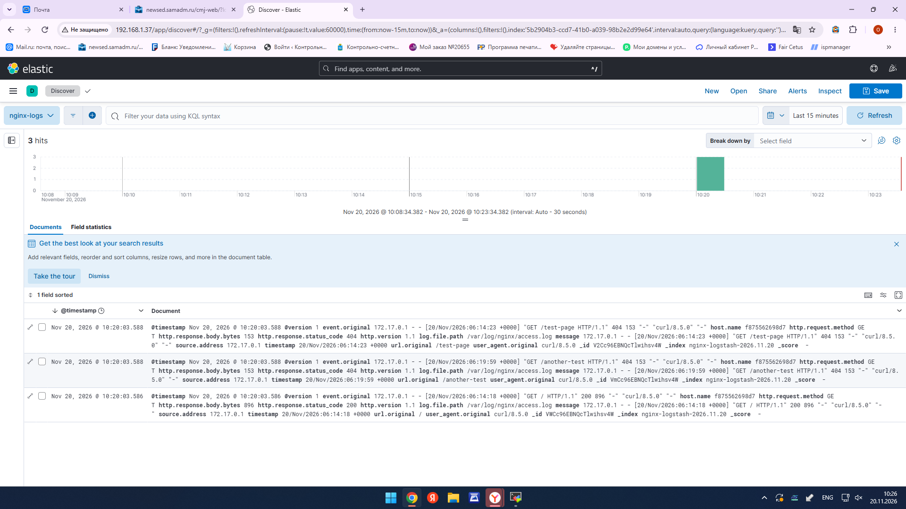
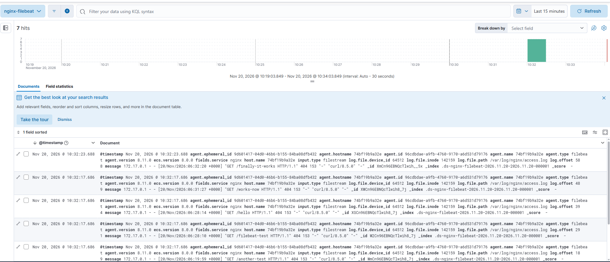
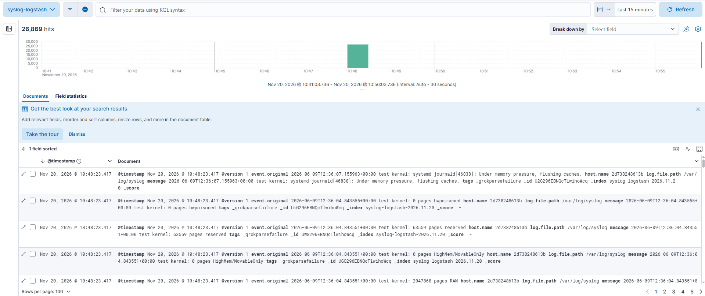
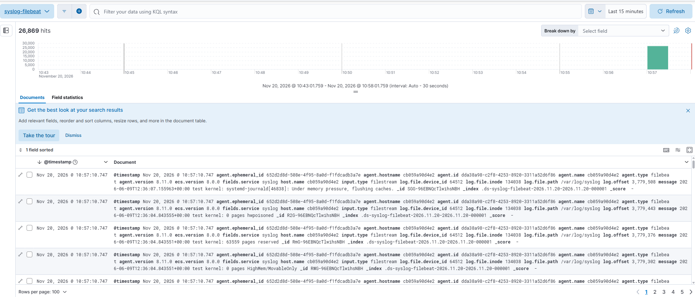

# Домашнее задание к занятию «Очереди RabbitMQ»

**Выполнил:** Нижегородцева Ольга Сергеевна

---

## Задание 1. Установка RabbitMQ

RabbitMQ был развернут с помощью Docker (образ `rabbitmq:3-management`), так как системная установка на Ubuntu 24.04 выдавала ошибки. Веб-интерфейс доступен на порту `15672`.

Скриншот веб-интерфейса RabbitMQ:


---

## Задание 2. Отправка и получение сообщений

Для работы скриптов был установлен Python 3 и библиотека Pika. Скрипт `producer.py` отправил сообщение в очередь `hello`.

**Скриншот очереди в веб-интерфейсе (Ready: 1):**


**Скриншот результата работы `consumer.py`:**


---

## Задание 3. Подготовка HA кластера

Кластер RabbitMQ развернут с использованием двух Docker-контейнеров (`rabbitmq1` и `rabbitmq2`), объединенных в сеть `rabbitmq-net`. Обе ноды используют одинаковый Erlang cookie для успешного соединения. Создана политика `ha-all` для репликации всех очередей.

**Скриншот нод в кластере:**


**Скриншот политики ha-all:**


**Вывод команды `rabbitmqctl cluster_status`:**


**Проверка сообщений через `rabbitmqadmin get queue='hello'` на обеих нодах:**


**Тест отказоустойчивости (Failover):**
Нода `rabbitmq1` была остановлена. Скрипт `producer.py` не смог подключиться к упавшей ноде, а `consumer.py` был перенастроен на порт второй ноды (`5673`) и успешно получил 3 сообщения из очереди.


---

## Задание 4*. Ansible playbook

Написан плейбук для автоматической установки RabbitMQ, настройки Erlang cookie, объединения нод в кластер и создания политики `ha-all`.

**Файл `hosts.ini`:**
```ini
[rabbitmq_cluster]
rmq01 ansible_host=192.168.0.10
rmq02 ansible_host=192.168.0.11
Файл install_rabbitmq_cluster.yml:
---
- name: Install and Configure RabbitMQ Cluster
  hosts: rabbitmq_cluster
  become: yes
  vars:
    rabbitmq_erlang_cookie: "MY_SUPER_SECRET_COOKIE"
    cluster_master: "{{ groups['rabbitmq_cluster'][0] }}"

  tasks:
    - name: Update apt cache
      ansible.builtin.apt:
        update_cache: yes

    - name: Install RabbitMQ server
      ansible.builtin.apt:
        name: rabbitmq-server
        state: present

    - name: Ensure RabbitMQ service is started and enabled
      ansible.builtin.service:
        name: rabbitmq-server
        state: started
        enabled: yes

    - name: Enable RabbitMQ management plugin
      ansible.builtin.command:
        cmd: rabbitmq-plugins enable rabbitmq_management
        creates: /etc/rabbitmq/enabled_plugins

    - name: Set identical Erlang cookie on all nodes
      ansible.builtin.copy:
        content: "{{ rabbitmq_erlang_cookie }}"
        dest: /var/lib/rabbitmq/.erlang.cookie
        owner: rabbitmq
        group: rabbitmq
        mode: '0400'

    - name: Restart RabbitMQ to apply cookie
      ansible.builtin.service:
        name: rabbitmq-server
        state: restarted

    - name: Stop RabbitMQ app on non-master nodes
      ansible.builtin.command:
        cmd: rabbitmqctl stop_app
      when: inventory_hostname != cluster_master

    - name: Reset RabbitMQ on non-master nodes
      ansible.builtin.command:
        cmd: rabbitmqctl reset
      when: inventory_hostname != cluster_master

    - name: Join the cluster to the master node
      ansible.builtin.command:
        cmd: "rabbitmqctl join_cluster rabbit@{{ cluster_master }}"
      when: inventory_hostname != cluster_master

    - name: Start RabbitMQ app on non-master nodes
      ansible.builtin.command:
        cmd: rabbitmqctl start_app
      when: inventory_hostname != cluster_master

    - name: Set ha-all policy on the master node
      ansible.builtin.command:
        cmd: rabbitmqctl set_policy ha-all ".*" '{"ha-mode":"all"}'
      when: inventory_hostname == cluster_master
