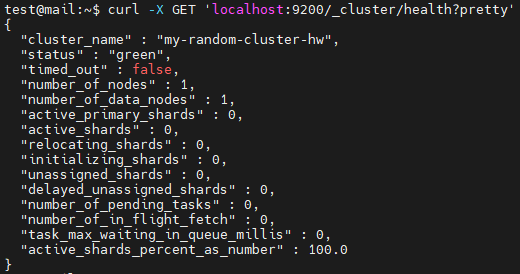
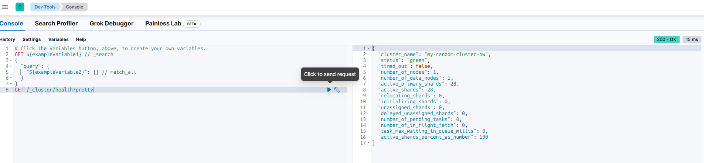

# Домашнее задание к занятию «ELK»

**Выполнил:** Нижегородцева Ольга Сергеевна

---

## Задание 1. Elasticsearch

Установлен и запущен Elasticsearch в Docker. Параметр `cluster_name` изменен на нестандартный.

Скриншот команды `curl -X GET 'localhost:9200/_cluster/health?pretty'`:

---

## Задание 2. Kibana

Установлена и запущена Kibana. Через интерфейс Dev Tools выполнен запрос `GET /_cluster/health?pretty`.

Скриншот интерфейса Kibana:

---

## Задание 3. Logstash

Установлен и запущен Logstash и Nginx. С помощью Logstash настроена отправка access-лога Nginx в Elasticsearch. Логи успешно распарсены.

Скриншот логов Nginx в Kibana:

---

## Задание 4. Filebeat

Установлен и запущен Filebeat. Поставка логов Nginx переключена с Logstash на Filebeat. Логи успешно поступают в Elasticsearch.

Скриншот логов Nginx, отправленных через Filebeat:

---

## Задание 5*. Доставка данных (syslog)

**Приложение:** Для выполнения задания был выбран системный журнал `syslog` (файл `/var/log/syslog`).

**Logstash:**
Настроен конфигурационный файл `logstash-syslog.conf` с использованием Grok-фильтра `%{SYSLOGBASE}` для парсинга полей.

Скриншот логов syslog, отправленных через Logstash (индекс `syslog-logstash-*`):

**Filebeat:**
Настроен конфигурационный файл `filebeat-syslog.yml` с input-типом `filestream`.

Скриншот логов syslog, отправленных через Filebeat (индекс `syslog-filebeat-*`):

